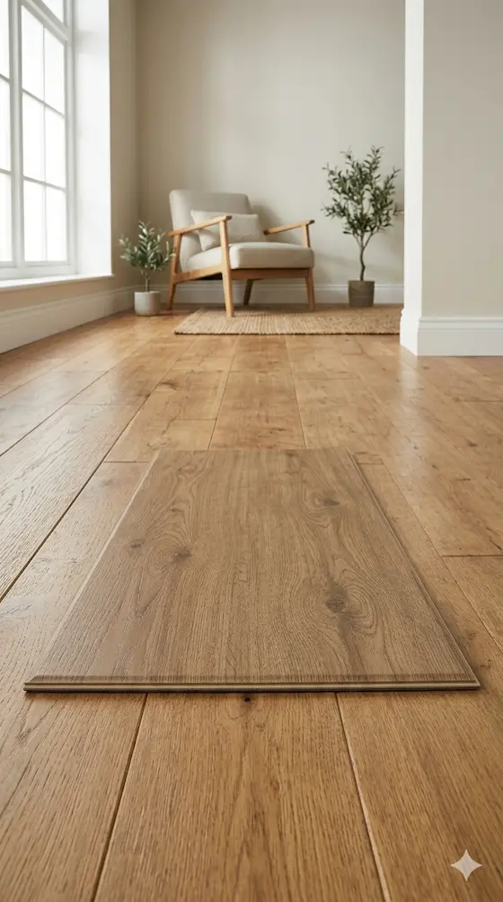

El tipo de suelo a instalar es una de las principales dudas que nos asaltan a la hora de realizar nuestra reforma. Normalmente solemos confiar ciegamente en la opinión de un experto o guiarnos simplemente por criterios estéticos, pero hay una pregunta que siempre se debe considerar a la hora de plantear cualquier remodelación del suelo de nuestra vivienda, ¿Qué tipo de suelo es más barato?. En este Post intentaremos indicarte el precio de los principales materiales, así como el coste de la instalación de los mismos.

## Precio de los principales tipos de suelo

El precio por metro cuadrado de los suelos más populares para viviendas, según proveedores de la Región de Murcia, es:

- **Suelo cerámico:** De 8€ a 15€ por m² dependiendo del grosor y dibujo de la baldosa, normalmente valen unos 10€.
- **Suelo vinílico:** El precio del suelo vinílico depende mucho de si se trata de un suelo vinílico en rollo, adhesivo o SPC. En general podemos hablar de unos 9-14 euros para las opciones en rollo, de 12 a 17 euros para el adhesivo y de 15 a 24 euros para los SPC.
- **Suelo Laminado:** De 10€ a 20€ el m², aunque hay opciones de hasta 37€. Es un suelo que dependiendo del uso que se le dé necesitará un mayor o menor grosor, resistencia al agua y la humedad y otros añadidos que influyen mucho en su precio.
- **Parquet:** A partir de 20€ el m² podemos conseguir un suelo de parquet para nuestra vivienda. Ahora bien, en este material más que en ningún otro la calidad de la materia prima y los acabados pueden disparar el precio. Hay opciones de parquet que se acercan a los 100€ el m², aunque la mayoría de opciones están en torno a los 35€ el m².
- **Mármol:** De 15€ el m² hasta 40€, dependiendo principalmente del color del mismo. Los tonos blancos son más caros que los rojizos y los tonos negros son los más caros.
- **Granito:** De 20€ el m² a 55€, de nuevo muy dependiente del color y patrón de la piedra.

## Coste de la instalación

A la hora de calcular el coste del suelo, es indispensable tener en cuenta el precio de la instalación. Por supuesto este precio varía mucho en función de los metros que queramos instalar o si hemos de levantar un suelo previamente instalado. Estos precios son, por lo tanto, orientativos, y se basan en la premisa de una instalación limpia de 50m². Los costes son los siguientes:

- **Suelo cerámico:** En caso de tratarse de una instalación limpia, sin necesidad de levantar el suelo anterior ni muebles que la dificulten, puede ser de tan solo 15€ por m². En caso contrario la instalación puede irse hasta los 25€ por m², y subir hasta los 40€ incluso si sumamos impedimentos de ubicación de la reforma y demás.
- **Suelo laminado y vinílico:** Ambos muy sencillos de instalar, tanto que incluso es viable instalarlo por cuenta propia. En caso de recurrir a un profesional el precio en una instalación limpia sería de en torno a 10€ por m².
- **Parquet:** En torno a 20-30€ por m² y, dado al alto coste del material y lo aparatoso de su instalación, se recomienda siempre acudir a un profesional a la hora de la instalación. Ha de tenerse en cuenta la humedad del ambiente a la hora de decantarse por un suelo que contenga madera noble, como es el caso del parquet.
- **Mármol y granito:** Si hablamos solo del precio de la colocación del mismo, este varía desde los 20€ por m² hasta los 40€. Aunque, siendo realistas, normalmente necesitaremos de un marmolista para que corte las piezas a medida de nuestra habitación y para que no rompa el dibujo de la piedra, en especial en el caso del mármol, por lo que un presupuesto realista sería de 40€ por m² a 80€. Además hay que tener en cuenta el coste de mantenimiento de estos materiales, que es muy elevado.

Como puedes imaginar el coste de la instalación es algo muy dependiente también del profesional en cuestión. Para elaborar esta lista nos hemos basado tanto en nuestros propios costes de instalación como en los de la competencia, puedes echarle un vistazo tú mismo en portales como [habitissimo](https://www.habitissimo.es/presupuestos/cambiar-suelo).

## Conclusión

Una vez analizados los principales tipos de suelo, su precio y su coste de instalación, podemos responder a la pregunta inicial, ¿Cuál es el tipo de suelo más barato?.

En términos absolutos, los suelos vinílicos y laminados son de largo la opción más rentable. En especial podríamos considerar a los suelos laminados como la opción más barata, pues se permiten instalación flotante y sin cola, simplemente encajando las piezas. Esto se traduce en que cualquiera puede instalar por sí mismo un suelo laminado.

### Detalles a tener en cuenta

Sin embargo, debemos de considerar las particularidades de cada suelo a la hora de decidir cuál es nuestra opción más rentable. Por ejemplo debemos tener en cuenta la exposición a la humedad, el suelo laminado tiene una absorción de humedad de en torno al 30%, mientras que el vinílico solo del 5%, lo que lo hace una gran opción para baños.

Otro aspecto a tener en cuenta son el desgaste que sufrirá el suelo, pues en una tienda de gran afluencia necesitaremos un suelo más resistente. A la hora de elegir nuestro suelo laminado debemos preguntar por el uso, que es la escala de resistencia que usan estos suelos. Tendremos que elegir entre uso privado, público o industrial entre otros, a mayor resistencia mayor grosor y precio del suelo.

No obstante, esto no significa que el resto de opciones no sean interesantes en el contexto adecuado, pues cada material tiene sus propiedades únicas y su propia función.

## Información adicional sobre suelos

Si quieres seguir profundizando sobre suelos o cualquier otro tema relacionado con las reformas y la construcción, [visita nuestro blog](/blog-de-reformas/). También te recomendamos que [solicites tu presupuesto](/presupuesto-reforma-murcia/) para tener una idea exacta del coste de cambiar el suelo de tu vivienda.

Cualquier duda [contacta con nosotros](/contacto/) o visita nuestra sede, estaremos encantados de atenderte.
